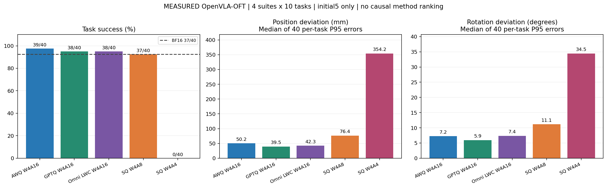
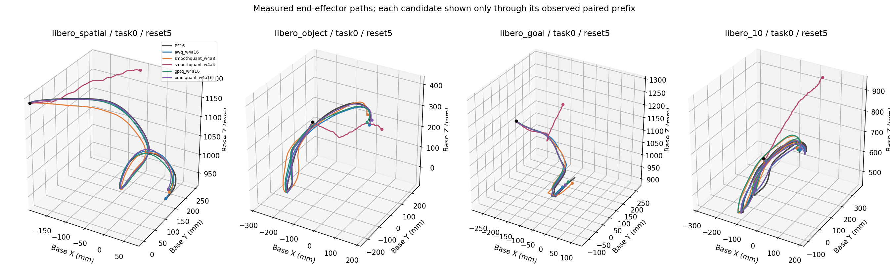

# 053本轮初期结论与收尾记录

截至用户2026-11-10要求收尾，采集已停止、GPU空闲。初态5完整，初态15只完成部分覆盖；等待用户下一次开机通知，不自动续跑。

## 可以直接看到的结果

四个LIBERO suite、每suite10任务、初态5，共40个BF16参考与200组量化配对，240条唯一完整轨迹审计通过。

| 配置 | 成功数/40 | 任务位置P95的中位数/mm | 任务旋转P95的中位数/° |
|---|---:|---:|---:|
| BF16参考 | 37 | — | — |
| awq_w4a16 | 39 | 50.2 | 7.2 |
| gptq_w4a16 | 38 | 39.5 | 5.9 |
| omniquant_w4a16 | 38 | 42.3 | 7.4 |
| smoothquant_w4a8 | 37 | 76.4 | 11.1 |
| smoothquant_w4a4 | 0 | 354.2 | 34.5 |

[全部八类实测图表](../20261110-053-five-methods-reset5-v1/index.html)，含所有40任务XY路径、控制步位置/旋转差异、同输入首动作、偏移起点，以及误差向量平均方向/离散度。

## 初期结论

1. **成功率接近，不代表走过的路径相同。** AWQ、GPTQ、OmniQuant仍有可测的位置和旋转差异；这些差异也未必需要全部补偿，因为任务可以成功，BF16参考自身也会失败。
2. **当前配方中的A4最明显退化。** SQ-W4A4在初态5为0/40，在已完成的初态15配对中也为0/32；位置和旋转差异都明显增大。这不能推广成所有A4方法必然失败，也不能据成功标签推断具体物理机制。
3. **尚不能认定存在一个普适拐点。** 不同任务的偏移起点、方向与幅度不同；多条轨迹有扩大现象，也有回落或纠正。不能把曲线尾段贡献任务变化当成统一事件，也未证明“平移只增加方差、旋转只积累偏置”普遍成立。
4. **还没有验证OPD补偿有效。** 当前是观测实验，没有修改量化方法或做补偿；后续闭环状态已分叉，偏移含反馈效应。下一轮可复用已存观测，在相同状态重放BF16动作，先分离直接动作误差与闭环累积，再考虑补偿。

## 尚未完成的覆盖

初态15共128条完整回合：32个BF16参考（31成功），AWQ29/32、SQ-W4A8为31/32、SQ-W4A4为0/32；96组配对审计通过，计划中的另104个量化配对槽位保留缺失。此任务覆盖不均衡，不与初态5直接做因果相减，不冒称完整第二初态。

GPTQ/Omni初态15未启动；初态25/35/45只做CPU输入身份与计划准备，未入场。五个预选初态在各任务内SHA互异，但不等于几何差异已经充分验证。累计已审计296组量化配对、72个唯一BF16参考，368条唯一完整回合；旧重复与中断排除。

DuQuant两精度目前仅CPU组件通过，QVLA发布工作流仅CPU分配/量化测试通过，没有真实OFT轨迹成绩；当前磁盘低于新方法12GiB门槛。ActQuant完整流程资源不足，QuantVLA两项OFT配方未验证，HoloQ完整DiT配方不适配本L1-head OFT。十二项没有冒称全做完。

## 备份边界与恢复

新归档1,046,506,250字节，SHA256 `39ad7990c7d8972beffad9b046199fdd285b3457153622e7f30b55f5688536a16`，8578成员服务器逐项校验通过；本机与私有仓库状态见对应验证JSON。它包含所有本日新原始轨迹（也覆盖早先云上传缺口的58条）、代码、控制与分析；此前已验证父归档通过独立恢复索引复用。

用户明确不上传/下载本轮新大参数。GPTQ约4.03GB、Omni约4.59GB，连同smoke与失败前缀均留在053持久盘，路径/大小/SHA见`SERVER_VERIFICATION.json`的parameter_exclusions。**云端参数副本缺失是明确保留的边界，不宣称全会话完整云备份。**

只测BF16反量化执行下的行为，未测原生INT4内核加速；profile格式不同，不能据文件大小直接比较部署模型存储。当前约定没有本轮Windows关机授权，本机保持开启。最终Git远端与053原生停机证据另附，平台OFF/计费不作独立确认。
