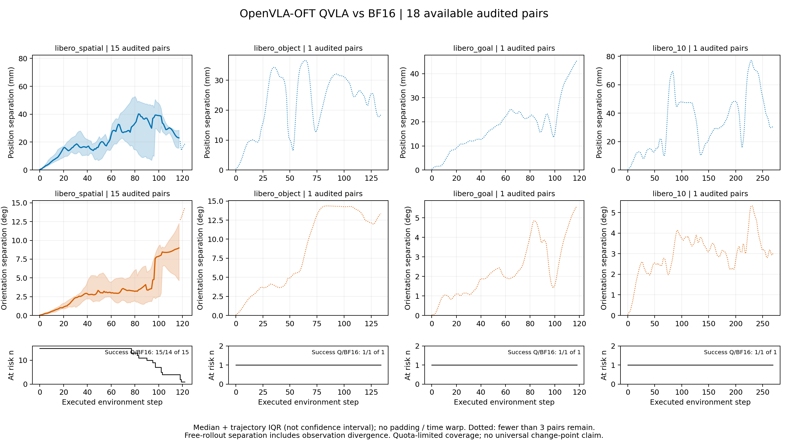
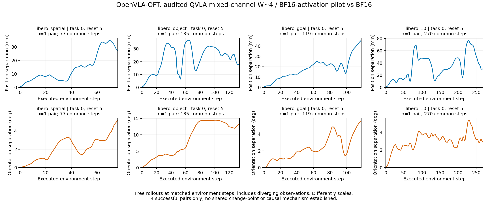

最终私有备份覆盖：41,209,842字节增量已上传私有仓库，完整下载SHA与原包一致；643源成员加1清单、18视频核验通过，82,419,684字节临时双份已清理。校准proxy和模型/历史父数据按RECOVERY_DEPENDENCIES与旧索引保留服务器，未冒称全部外部依赖已上云。

最终关机覆盖：061于2026-11-12 19:49:49北京时间取得原生execute=true回执，SSH随后关闭；当前低频跟进随实例终止。平台OFF/计费未独立核验。Windows保持开启。

# 本轮额度停止后的整合结果

已在实际15%门限停止扩展，最后一条正常结束；18条完整QVLA轨迹全部通过原始查询/动作/位姿/视频及同初态配对审计。QVLA18/18、同覆盖BF16 17/18，1救回0新增失败。Spatial15对，Object/Goal/Long各1对；这是按既定suite顺序遇到额度停止形成的覆盖偏斜，不作方法排名或跨suite共性结论。此前480条加本轮18条，累计498条唯一完整病例；QVLA同80目标仍缺62，不称十二配置或五初态完成。

实线和阴影为逐环境步中位数与轨迹IQR；虚线表示剩余不足3对。终止后不补零、不做时间拉伸。Spatial多条轨迹存在逐步分离，但另外三suite仅1条，当前不能确定跨任务、跨suite共同拐点。v1汇总图曾因自动纵轴被锁到[0,1]而截断，视觉审计发现后保留原件，以上独立v3只修正图轴，覆盖全部原始轨迹范围；原始数据和实验不变。原始快照包含v1，正确v3源码/PNG同步普通Git可重新生成。

本轮41,209,842字节增量，643源成员/18原视频本机逐SHA核验通过；私有上传与原生关机以随后对应收据为准，不能把阶段暂停当成已经关机。以下为接入与多阶段详细日志。

# 061重新开机后的合理配置接续

## 整合结果与当前边界

当前用户要求是继续其他合理配置，额度达到门限再收尾。061本轮GPU UUID为`GPU-57fe5e94-17ed-8960-1d47-76090d594f69`；不继承上一轮已关机状态。此前480条完整病例保持不动。阶段完成只暂停并立即准备接续，根控制器在新鲜primary剩15%停止扩展、10%终止保存后请求原生关机；本轮没有Windows关机授权。

新增QVLA采用固定官方OFT源码`6d0a074459aa7efa09ef0cc86cfc339ce40d8b06`中的动作Jacobian残差敏感度、原始分配器与注入器。4个suite各一个reset0校准输入，与评测reset5/15分离；这是本地小预算设置，不称论文完整复现。435个注册目标中422个有动作梯度，13个动作梯度断连的目标保持BF16；断连不表示前向不执行。通道平均位数为4，允许0/4/8/16混合；不能解释为全模型参数加权W4。激活和受保护组件为BF16，当前为数值量化诊断，不是INT4内核速度结论。

原生真实BF16查询与既有参考动作逐位一致；原始量化注入后全finite、底座冻结、保护组件未变、保存重载后权重及动作逐位相同，实际GPU门禁通过。四suite各task0/reset5的小测全部完成并通过原始观测、动作、位姿、视频及真实初始输入配对审计：QVLA与BF16均4/4。此样本只支持进入轨迹采集，不能证明整体成功率或漂移拐点共性。

| Suite | 共同观测动作步 | 平移差P95 mm | 旋转差P95 ° | 同输入首动作块MSE |
|---|---:|---:|---:|---:|
| Spatial |77|33.48|4.27|0.000695|
| Object |135|34.46|14.34|0.001099|
| Goal |119|40.07|4.86|0.000437|
| Long |270|69.95|4.62|0.000679|

这些是同环境步下两条自由运行轨迹的相对差，包含闭环状态分布分离，不等于单步量化误差；首动作块才是严格同输入动作差。P95是轨迹内描述统计，不是置信区间或统一补偿阈值。

[PDF](qvla-pilot-drift.pdf)与[派生曲线数据](pilot-curves.json)。每个面板仅一对轨迹、纵轴不同；曲线没有补零、时间拉伸或人为对齐阶段。出现上升、回落与局部波峰，但不能从4个task0样本宣布存在统一拐点。

2026-11-12 11:25:44 UTC已实际启动`qvla-complete80-v1`，supervisor6289，计划SHA`6db3a8a5d2c802f44149c4fa9fae5833abc071bacdc407e78e4591b461350d79`。仅补76条，连同小测共80条目标；四suite、十任务、初态5/15，复用现有80条BF16参考。不根据成绩选病例；未到终态前不报80完成。

## 准备失败与修复日志

所有失败原目录保留，不纳入模型成功率：

1. calibration-v1脚本名包含bridge，触发上游基于argv的BRIDGE常量，动作形状合同拒绝；v2显式LIBERO参数后原生输入和动作逐位桥接通过。
2. pilot-v1错误要求435层都有动作梯度；原始校准实际422层有梯度，v2按真实目标集合核验并保护其余13层。
3. pilot-v2执行器未显式冻结模型，冻结合同拒绝；v3显式冻结。
4. pilot-v3误把梯度断连当作前向不执行，保护钩子拒绝；v4改为注入前后核验13层权重SHA不变。原始量化公式、seed、输入/动作容差均未放宽。

## 后续方法接入边界

DuQuant完整块级旋转、共享激活量化器与LET配对绑定尚待OFT视觉/语言整图验证；单Linear原语通过不能冒称原方法已接入。ActQuant官方支持OFT，但切换GGML后端，需独立BF16后端桥接和参考配对，不能直接并入现有PyTorch漂移差。官方README要求约50GB临时盘；061现有约62.7GB不能直接判定不足，需逐项预算构建/导出/校准峰值并保留6GiB。当前不让其占用正在采集QVLA的GPU。

084继续无卡CPU准备状态，没有启动GPU模型。旧父包云端恢复缺口和参数仅服务器保留边界不因本轮变更而消失。

证据位于`stage-evidence/`；这是阶段快照，最终收尾另补收据和恢复索引。活动原始数据保留061，尚未声称本轮最终私有备份完成。
