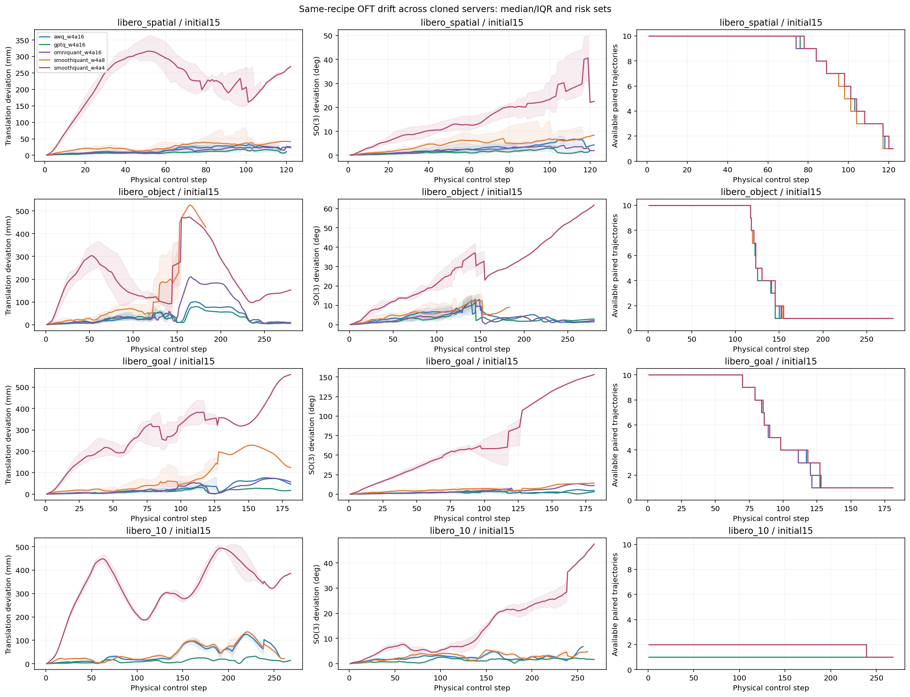
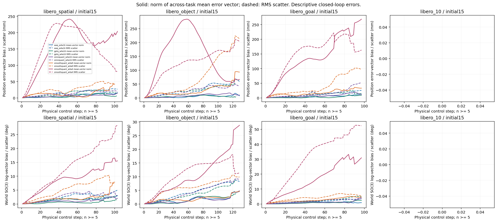

# 061用户收尾：053克隆接续结果与恢复

用户要求“准备收尾关机，下次开机再继续”后，已停止新派发并终止自有GPU策略，GPU空闲。没有继续Long或开启任何其他服务器；Windows保持开启。当前正在完成最终Git与061原生关机，真实关机回执另附，不先称平台OFF。

## 整合后的结果与分析

本轮新增61条完整轨迹、两个中断尝试保留排除；继承053的368条后，累计429条唯一完整轨迹（357个量化配对、72个BF16参考）。四条BF16重复对照另存，不计分母。初态5全40任务×6条件维持原结果；本轮仅补初态15，不改量化方法、训练、校准、种子或动作执行节奏。

初态15共有32个BF16参考，31成功；量化配对157个，缺43个配对及8个BF16槽位，总剩51个实验槽位，全部在Long。Spatial/Object/Goal的五种量化方法均覆盖各10任务；Long中GPTQ仅1例、Omni为0例，其他三量化条件各2例。覆盖不一致，不能据下表跨方法公平排名。

| 初态15条件 | 成功/有效回合 | 每任务位置P95的中位数/mm | 每任务旋转P95的中位数/度 |
|---|---:|---:|---:|
| awq_w4a16 | 29/32 | 31.93 | 4.43 |
| gptq_w4a16 | 30/31 | 26.51 | 3.40 |
| omniquant_w4a16 | 28/30 | 28.90 | 4.99 |
| smoothquant_w4a8 | 31/32 | 69.00 | 7.15 |
| smoothquant_w4a4 | 0/32 | 345.49 | 32.63 |

当前SQ-W4A4在已覆盖的两初态明显退化，其他配方也存在可测的轨迹偏差；它们并非每任务同一控制步出现相同拐点。只能描述当前配方和已覆盖病例，不能推出所有A4方法都失败，也未证明OPD补偿有效。闭环差异包含后续状态分叉；同首输入动作块另列直接量化动作差异。

[五类实测图表](measured/index.html) · [完整统计/缺失格](measured/summary.json) · [逐query/动作/位姿/视频审计](measured/raw-audit.json) · [恢复入口及51个精确缺项](RESTORE_INDEX.json)。平移以mm计、旋转用SO(3)测地角；只用真实共同控制步前缀，不补零或时间扭曲。偏置/离散度图仅绘制至少5个有效任务，曲线尾部样本数单列，不能把有效任务更换造成的跳变认作共性拐点。3D视图采用预先指定task0及XYZ等比例坐标。冻结5mm/2度/连续5步描述性窗口规则没有调整。

## 克隆、运行与中断日志

053→061已验证25模型文件、四个量化profile及不变科学源码/父原始清单。父1,046,506,250字节归档完整SHA与本机原件相同；两项封存后更新的派生HTML/归档自身日志单列，不豁免科学文件。只变更主机/GPU身份、round_id、输出/控制目录与授权。原科学执行器仍来自冻结053代码，model_seed7、实际env_seed0、8动作/query不变。

第一段20261111-061-oft-initial15-clone-v1完成22例，真实API窗口交界旧reset到期触发保护中断；新API确认刷新后，以独立第二段20261112-061-oft-initial15-clone-v2继续，未重跑22例。第二段完成39例后收到用户收尾指令，Long task0 Omni部分轨迹排除。第一段Object task1 GPTQ中断已在第二段完整补齐；两次部分输出均封存，不计模型失败或完整回合。

本轮61个完整策略子进程墙钟合计6587.215秒，另保留两次中断、控制等待和CPU审计成本，详见NEW_CASES_AND_COST.json及原始控制/trace。包含启动、SHA、加载、数值gate和trace/video，不是INT4内核延迟或部署加速。

控制层独立准备了可选90秒真实API确认暂停机制，通过5项新合同及原infra/暂停合同共14项CPU测试；不按钟点猜刷新、不放宽15%/10%阈值，未覆盖本轮冻结代码或冒称实际GPU暂停验证。自动审批拒绝了用户改为收尾前已排队的继续心跳操作，该操作未执行，之后仅进行停止/备份/关机。

## 备份边界与关机

两个新增私有增量包合计147,596,444字节：v1为45,308,069字节/457成员，v2为102,288,375字节/883成员。服务器自验、本机逐成员SHA和私有远端分块下载/整体SHA均通过，合计1340成员。V1初次单块上传遇GitHub starter资产HTTP503，保留旧资产，独立32MiB双块验证通过；V2成功双块未重复传输。

只传本轮新增原始轨迹/控制/源码材料。模型和大GPTQ/Omni参数按用户授权留061持久盘，不传本机或云端；旧1.05GB父原始包的历史私有读回缺口仍保留，两端已验证原件不删，不称全会话完整云备份。本机仅保留小报告和本轮临时核验缓存，原始包不进入公开Git。

用户收尾后已停止本轮GPU并终止本轮结束后的等待控制器，当前控制端只完成集中Git和立即原生关机；不再派发病例。原生execute=true及平台OFF/计费证据以最终补充回执为准。
