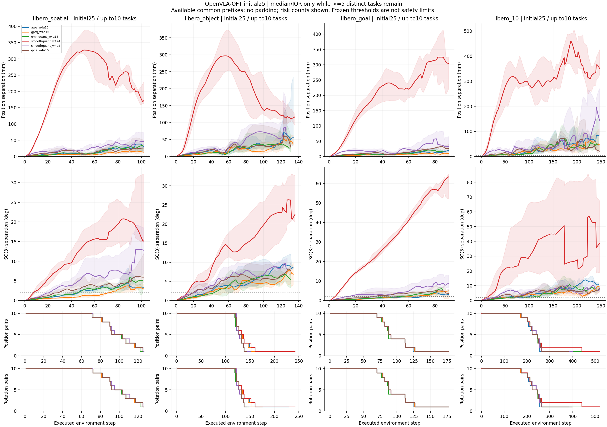
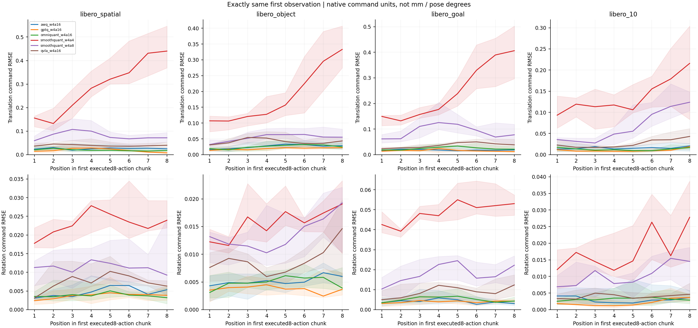
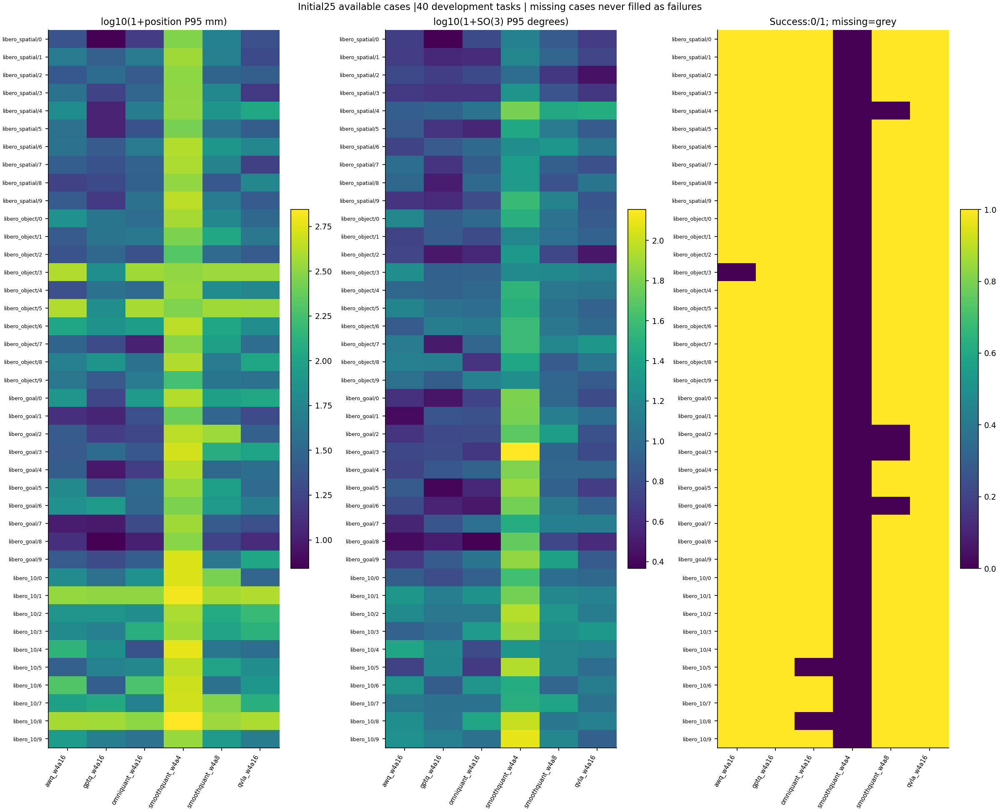

# OpenVLA-OFT 初态25：六类量化轨迹对照

## 整合结果与分析

本轮新增240条唯一完整量化轨迹，复用40条既有BF16参考（39/40成功），没有重跑参考。四个LIBERO suite各10任务，初态25，模型seed7、环境seed0、每次执行8个动作。原始轨迹身份、首观测配对与原有几何审计保持一致；中断片和控制错误保留，不补记成功或失败。

|配置|本轮成功/40|救回/新增失败|三初态累计成功/120|位置P95的任务中位数 mm|旋转P95的任务中位数 °|
|---|---:|---:|---:|---:|---:|
|AWQ W4A16|39/40|1/1|114/120|40.07|6.62|
|GPTQ W4A16|40/40|1/0|117/120|29.76|6.18|
|OmniQuant W4A16|38/40|1/2|114/120|36.19|7.41|
|SmoothQuant W4A8|36/40|1/4|111/120|68.45|10.78|
|SmoothQuant W4A4|0/40|0/39|0/120|362.46|34.57|
|QVLA 混合约W4A16|40/40|1/0|115/120|44.85|7.81|

BF16三初态合计114/120。累计840条唯一完整轨迹＝BF16及六量化条件各120条，另4条历史重复控制单列；这是同40任务、初态5/15/25的描述，尚未完成五初态1400条目标或十二配置/跨模型验证。

1. 最明确的重复现象是SQ W4A4大幅失效：三个初态累计0/120，本轮四suite都出现明显较大的位置与旋转分离。SQ W4A8的分离通常较W4A16配置更大，但仍可成功；成功率不能代替轨迹质量。
2. 本轮全部240对都有持续5步超过5mm的位置分离，234对有持续旋转越界（2°）。因此“越界”本身不能作为失败或可补偿拐点判据；这是相对于BF16执行轨迹的分离，包括闭环反馈放大，不是纯同状态量化误差。
3. 四suite曲线的明显偏离时间与后续变化不同，当前支持严重A4配置的跨suite漂移现象，不能据此宣称存在所有方法共享的单一拐点，也没有证明OPD有效。首个完全相同观测下的8动作块用于分离初始模型误差；以后仍需在相同状态上交叉查询教师与量化模型、结合阶段/接触/夹爪事件检验候选补偿窗口。
4. GPTQ和QVLA本轮各40/40，但样本小、同任务开发、配置位宽方案不同，不据此做方法优劣或因果排名。不改方法、不训练、不按成绩选择后续条件。

## 可视化与数据

图1：共同可观测前缀上的位置/SO(3)分离；任务数不足5后停止画中位数/IQR，下方保留实际风险集，不补齐轨迹长度。阈值沿用历史重复控制，未根据本轮调节。

图2：完全相同首观测下8动作块各位置的指令RMSE，单位是原生动作指令，不是毫米或位姿角度。

图3：40任务的位置/旋转P95与成功标记，P95热图采用log10(1+x)，缺失为灰色。全部派生指标见[summary-public.json](summary-public.json)。

## 多轮运行日志与恢复边界

- 2026-11-15：冻结模型、profile、父数据与600条已有病例身份核对后，依次完成AWQ、GPTQ、OmniQuant。
- 11月16日01:57北京时间：实际primary剩10%，保护器停止SQ8；已完整32条，中断轨迹保留。随后用户追加本窗口暂不收尾指令，关机请求在发出前撤销，以独立恢复片补齐剩余8条，真实输入/原始轨迹审计通过。
- 控制入口曾因Windows文本编码失败、保护状态尚未重置导致注册拒绝，未启动GPU；原记录保留。独立版本修复后接续，未覆盖旧计划/锁或科学源码。
- 11月16日02:28:51北京时间（11月15日18:28:51UTC），实际API确认reset窗口改变；旧保护器在新额度同步前约4秒按旧reset到期停了SQ4，未发原生关机。新控制版本加入120秒实际刷新确认缓冲，缺项恢复片按病例去重接续，原中断片保留。
- 新窗口恢复15%停扩展、10%收尾；当前窗口豁免已消耗且不能再次激活。一次后续心跳因自动审批连接中断未执行，重试期间旧额度超过17分钟，保护器进入收尾；当时QVLA已全部完成，控制事件单列。
- SQ4原片与恢复片合计40条；最后QVLA40条四suite及audit全部exit0。最终分析合并所有终态stage，240对无缺项、无重复。部分启动回执的显示字段仍写40；恢复片实际工作量以冻结series缺项列表及最终240唯一病例审计为准。

## 方法接入准备与未完成项

DuQuant仅完成CPU解码层API/dtype适配：真实4096/11008宽度、随机权重、关闭量化时与HF参考逐位一致；这不是完整7B量化、原LET/LWC重建、cache或实际动作门禁通过，未加入GPU实验。ActQuant仍有AMF资源与OFT连续动作桥接门禁；QuantVLA、Holo等未完成OFT接入，不冒称十二项均可运行。π0.5/GR00T本轮未启动。

## 备份与收尾

只备份本轮增量；原始观测/动作、视频及控制证据进入私有归档，公开Git仅代码、派生指标和报告。大参数按用户授权留服务器，并保留历史云端缺口索引；不重复转移模型或历史全量包。最终备份/原生关机结果见完成后的收尾补充。Codex定时任务本环境未建立，未冒称回复结束后自动监控；本轮为当前任务内低频检查。

### 本轮备份核验通过

853,230,526字节增量包，SHA256 `a53246a38035fb054024f1cfc4f6faaffd090dbc6768006285b991681373ca52`；7,289成员逐项通过，240原始视频、5,668 NPZ完整保存。私有归档4块上传及全部下载SHA/完整文件重组校验通过。完整私有回执保存在私有收尾材料，公开仅恢复所需摘要；当前准备提交本轮代码/报告并执行061原生关闭。服务器及本机原件暂留，不假称历史云端缺口已补齐。

### 本轮原生收尾回执

2026-11-16 05:05:26北京时间（11月15日21:05:26 UTC）取得当前061原生 `execute=true` 回执，发出前GPU空闲、全部实验进程已停止；SSH随后关闭。该回执仅证明原生停止请求，平台OFF与停计费未独立核验。当前任务内心跳与临时监听结束，没有创建或恢复旧Codex自动化。用户本轮独立授权正常关闭Windows；本机关闭只在最终收尾核验和总结发送后请求，不强制应用。
