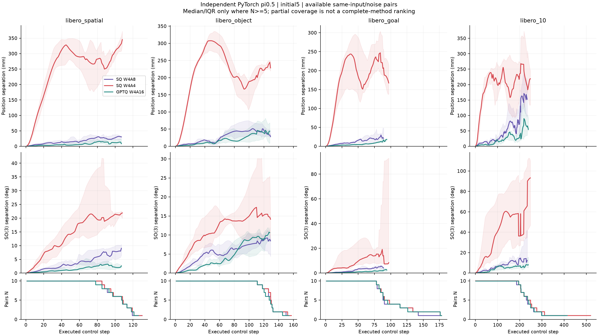

# π0.5同后端量化轨迹接续：本轮实际结果

## 综合结果与分析

当前统计仅为独立PyTorch后端、初态5的同40任务；原生JAX参考39/40与旧JAX→Torch等价检查失败均独立保留，不跨后端合并。

|配置|完整病例/计划40|成功/完整病例|对应BF16成功|救回/新增失败|位置P95任务中位数 mm|旋转P95任务中位数 °|
|---|---:|---:|---:|---:|---:|---:|
|BF16 Torch|40/40|39/40|39|-|0（自比较）|0（自比较）|
|SQ W4A8|40/40|39/40|39|1/1|56.862|9.672|
|SQ W4A4|40/40|0/40|39|0/39|316.357|25.684|
|GPTQ W4A16|40/40|40/40|39|1/0|24.734|7.856|

共160条唯一完整、120对量化/BF16配对。完整数不足40的配置按实际覆盖列示，不以缺项补失败、不据不等分母排名。待完成列表保存在summary-public.json；五初态/十二配置仍未全部完成。

几何口径：同实际控制步的末端位置欧氏距离（mm）及SO(3)相对旋转主角（度），只比较共同可观测前缀；先计算每条轨迹P95，再取已有任务中位数。该分离包含闭环反馈，不是纯同状态量化误差，也不自动构成共性拐点或OPD补偿收益证据。

中位数/IQR只在至少5个任务有共同前缀时显示；风险集为实际N。稀疏suite不画聚合曲线，标量病例仍保留。

## 数值门禁与控制问题

原始GPTQ414层产物完成后，动作保存重载门禁失败。源代码和CPU状态转换显示，旧生产器在量化后恢复了模型加载前的highest设置，而第二次原生模型构造使用high。独立GPU验证复用了同一414份权重（无重新量化），统一原生high后四个标定样本重复及重载逐位一致；反切旧TF32设置时四样本最大动作差约0.0010-0.0019。这支持精度状态合同不一致的解释，修复的是评测/持久化桥接，不是改进GPTQ量化公式或放宽误差容限。

GPTQ框架名称未登记和源快照路径越界的早期拒绝均发生在正式轨迹前，保留为控制失败，不计模型成绩。额度观测递送中断触发的收尾、首次归档因可变状态文件而失败也单独保留；用户明确授权后，仅在静态归档逐成员验证、GPU闲和新鲜额度有效时恢复。静态归档不含414份参数分片，参数保留服务器及SHA索引。

## 数据与成本

每例原始query、query-index固定噪声、实际执行前5动作、连续位姿、成功/终止信号与视频都重新按对应冻结审计器核验。只有PASS且完整的初态5开发轨迹进入统计，校准reset0及中断片不加分母。流程保持原生10×32流动作、模型seed7、每query的NumPy default_rng(0)噪声。

- BF16 Torch：1243次策略查询；环境与query墙时合计838.723s；含校验/加载墙时合计3679.838s。
- SQ W4A8：1269次策略查询；环境与query墙时合计1117.021s；含校验/加载墙时合计4049.904s。
- SQ W4A4：2640次策略查询；环境与query墙时合计2118.334s；含校验/加载墙时合计5076.952s。
- GPTQ W4A16：1241次策略查询；环境与query墙时合计821.450s；含校验/加载墙时合计4168.120s。

计时含环境、保存/视频、校验和加载；不是纯前向延迟或真实INT4内核速度。大参数只留服务器，原始增量与完整控制记录按私有备份规范另行封存。

## OpenVLA-OFT报告交付

另行交付的OpenVLA-OFT报告使用最新初态25的40任务，综合图剔除SQ W4A4，包含关键表、四suite漂移曲线、3D/XY/XZ/YZ固定样例，以及可切换40任务的离线交互HTML。PDF6页逐页渲染、HTML40任务切换/画布测试通过；280条参考/候选几何来自已验证归档，重算P95与原分析一致。输出保存在用户指定D盘目录。
