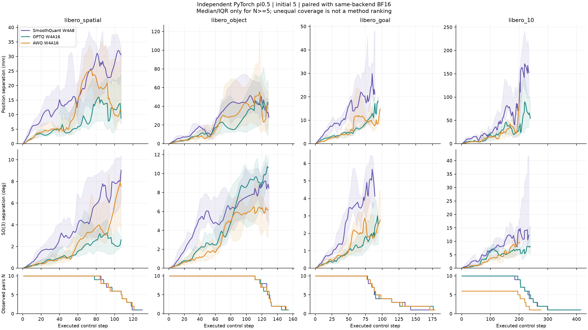

# π0.5 AWQ新增配置：已审计结果

## 结果与分析

仅统计初态5、独立PyTorch同后端的实际完整病例；四suite各10任务。中断前缀不计失败、不补造缺失结果。

|配置|完整/计划40|成功/完整|与BF16配对数|位置P95中位数 mm|旋转P95中位数 °|
|---|---:|---:|---:|---:|---:|
|BF16|40/40|39/40|0|—|—|
|SmoothQuant W4A8|40/40|39/40|40|56.862|9.672|
|GPTQ W4A16|40/40|40/40|40|24.734|7.856|
|AWQ W4A16|36/40|36/36|36|33.332|7.862|

AWQ各suite实际覆盖：

- libero_spatial：10/10完整，10成功。
- libero_object：10/10完整，10成功。
- libero_goal：10/10完整，10成功。
- libero_10：6/10完整，6成功。

上述曲线是各自闭环轨迹在相同已执行控制步上的末端位置距离与SO(3)角距离，包含反馈和进度差异，不能直接称为同状态纯量化误差。

成功率接近不表示动作或轨迹逐位一致；几何分离存在也不自动证明失败、统一拐点或OPD有效。需要进一步检查跨任务重复出现的偏离阶段，并区分同观测动作误差与闭环状态分离。

当前覆盖不等时，表中中位数只描述已有病例，不据此排名方法。曲线仅在风险集N≥5时画中位数/IQR，较晚阶段的样本减少可能改变曲线形状。

SQ W4A4历史数据仍在原始汇总中保留；用户已取消其初态25/35/45未完成部分。为便于观察其余方法，本图不叠加该失效配置；不将取消项补作失败。

## 方法与证据边界

AWQ为原始算法的W4A16静态量化：63块/414目标投影、32个校准查询；未微调模型、未根据闭环成绩调参数。完整模型冻结、finite、教师恢复和独立保存重载实际门禁通过后才采集轨迹。四suite首例属于正式40例，后续不重复计数。

本实验使用独立PyTorch后端；原生JAX与历史JAX→Torch桥接失败单独保留，不跨后端合并。量化权重在当前路径反量化后执行，不把墙时或显存解释为真实INT4内核收益。

## 查询与成本

- BF16：1243次策略查询；含验证/加载墙时合计3679.838s。
- SmoothQuant W4A8：1269次策略查询；含验证/加载墙时合计4049.904s。
- GPTQ W4A16：1241次策略查询；含验证/加载墙时合计4168.120s。
- AWQ W4A16：1058次策略查询；含验证/加载墙时合计3894.727s。

计时含加载、校验、环境、query及保存/视频。校准成本和未完成控制阶段在轮次日志独立记录，不作为上述完整轨迹的成本。