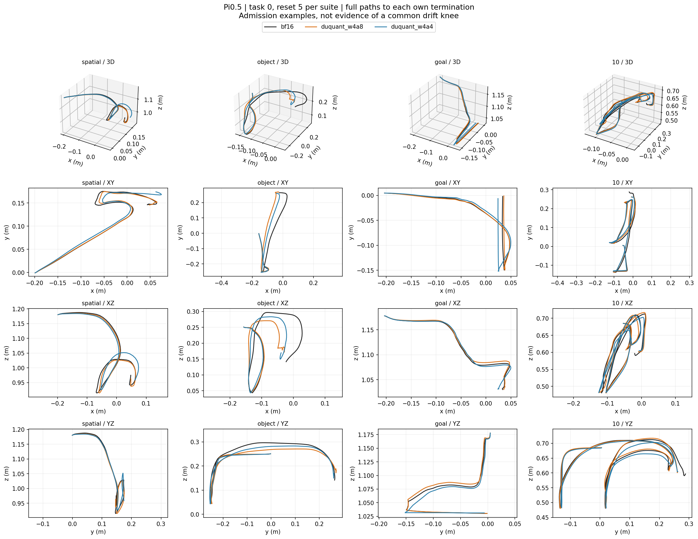
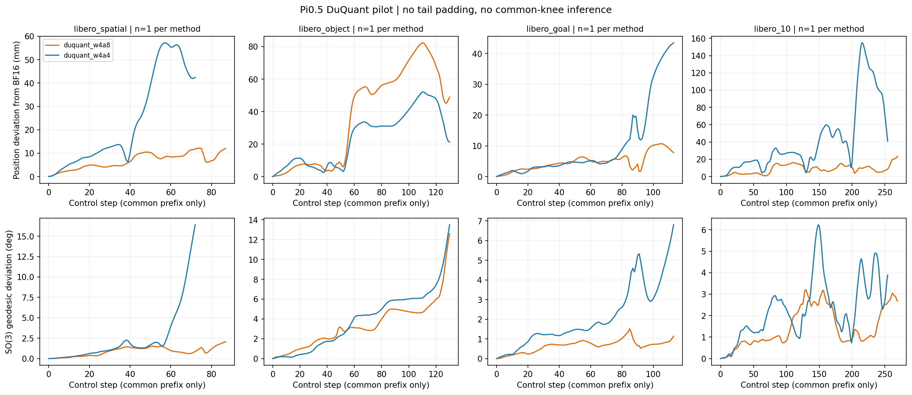

# π0.5：452同步回084后接续

## 已核验的结果与边界

本轮2026-11-20重新授权084有卡接续。模型、已有量化profile、452的DuQuant W4A8正式标定产物、科学源码及标定输入已逐SHA核对。原五初态BF16为197/200；GPTQ、AWQ、OmniQuant LWC、SmoothQuant W4A8各120条，成功119、118、119、119；SQ W4A4历史0/80保留，未来病例取消。这些是继承结果，不是本轮新增。

452的DuQuant W4A8全414投影数值门禁通过：32条固定标定输入、四suite未量化旋转对照RMSE均≤0.002、max abs均≤0.02、独立重载动作逐位一致。profile SHA为`81dfd16fac1189d7b703feb3ceb599e1d6c8b547eadfa52d6ac64658c2c238af`。这是数值入场证据，尚不能据此报告闭环成功率或真实INT4内核加速。

本轮task0/reset5的四suite DuQuant W4A8与W4A4最小验证均已实际exit0并通过完整原始审计，分别4/4成功，合计8条正式新增。W4A4独立32条标定及全414投影数值门禁通过，49次含验证的policy调用、724.506秒、GPU峰值13,706,919,936字节；profile SHA为`618cd76ced6fb6257d8cc5b8e82ff1aa2983c9b2a01c6dd379e247915029a4ff`。内部配对乘法FP32、输出保持原生dtype，是fake quant执行，不是实际INT4内核速度或显存收益。

随后GPTQ初态35固定16个缺项完成13条，13/13成功且原始审计通过；Spatial/Object/Goal各task0–3、Long的task0完成，Long task1–3因新鲜primary到14%而未启动。不是模型异常失败，不把未启动病例加分母。GPTQ累计132/133，仍缺初态35的27条及初态45的40条。本轮共新增21条完整轨迹；各条件分别统计，不跨条件合并为模型成功率。

原π0.5后端、seed、固定噪声、10×7动作块/每次执行5步及四suite病例设置不变。其他方法按来源、资源和真实适配状态分别登记，不将Hessian代理冒充动作梯度QVLA。QVLA动作版6个源码文件已补齐，量化器与既有OFT实验SHA一致；独立v3十步动作图前置在四suite通过：原生动作逐位一致、双相机/语言/十次去噪梯度有限非零、被mask占位相机梯度精确零，81.668秒、峰值7,734,639,616字节。尚未完成物理动作敏感度、位宽分配、量化注入重载/pilot，不称QVLA已入场。

前置v1只申请噪声梯度，前缀梯度未被请求；v2把被mask的第三相机计入有效回传次数，断言失败。两份失败源码和日志保留。v3显式区分真实双相机与占位相机，并验证占位梯度为零，未修改模型/轨迹协议或数值门限。

未解决的5项为QVLA、ActQuant、QuantVLA A8/A4、HoloQ。它们分别缺完整适配、官方流程资源/运行时桥接、原生flow ATM/OHB绑定或来源确认，仍记缺失，不等于架构不适用或已完成。阶段A仅通过“已入场或明确阻断登记”，不是所有配置都验证成功。

## 轨迹样例与初步分析

下表是每条轨迹与同case BF16参考在共同控制步前缀内的偏离P95。位置用毫米，旋转使用SO(3)测地角、单位度；在较早结束处停止，不用末帧填充。每suite每方法n=1，不能据此排序总体性能。

| Suite | A8位置 / 旋转P95 | A4位置 / 旋转P95 |
|---|---:|---:|
| Spatial | 11.70 mm / 1.64° | 56.31 mm / 11.32° |
| Object | 79.47 mm / 6.81° | 50.10 mm / 8.67° |
| Goal | 10.31 mm / 1.11° | 40.24 mm / 5.26° |
| Long | 15.97 mm / 2.96° | 132.60 mm / 4.91° |

成功率相同仍存在轨迹分离；同控制步偏差也包含完成进度、执行时长与闭环反馈差异，不能直接归因为模型动作误差或物理机制。尚未证明跨任务/初态的共性拐点，更没有OPD补偿有效性结论。

## 控制与恢复

- 当前控制根：`/root/autodl-tmp/trajectory-drift-20261107/control/20261120-084-pi05-resume-from452-v1`。
- 当前源码：`/root/autodl-tmp/trajectory-drift-20261107/code-084-pi05-resume-20261120-v1`。父452源码/计划/结果保持原字节，复制清单见`CODE_ROOT_LINEAGE_V1.json`。
- 本轮hostname：`autodl-container-b1f2438ea7-3f2e1d44`；boot：`0b257c37-0414-45e1-9494-ee869c127e64`；GPU：`GPU-9feb14a4-57db-f90f-db7a-2c2ba4be4d9d`，RTX4090 24564MiB。身份仅本轮有效。
- 新保护器1290、新授权SHA `54f497d256af8de5fe1d89aafcc394019a246eca700cf7c254df294b8e4a2508`；旧452 PID、授权、额度和关机回执不继承。
- 约15分钟简短状态检查由当前聊天任务执行，未创建回复结束后自动调度实验的应用任务。独立额度递送仅每5分钟递送真实五小时primary，不选择下一实验。
- 五小时primary剩15%停止扩展并保存、10%保存终止并原生关084、留3%；整任务完成且审计通过或实际GPU连续空跑30分钟也收尾。配置结束继续下一就绪项；未知/过期额度暂停告警，不虚构门限。
- 控制端明确操作预算覆盖本次primary窗口与收尾，至北京时间2026-11-21 00:28:29；这是控制有效期，非用户指定结束时刻，须提前一小时审阅，不静默延长旧SHA。
- 代码、小结果、综合任务日志结束时一次集中Git同步；原始轨迹仅私有增量归档，参数留服务器并列云端缺口。本轮没有继承旧轮Windows关机授权。

## 多轮日志

1. 北京时间18:25实测084已开卡、GPU空闲、磁盘21,154,226,176字节。
2. 18:27模型/profile/冻结源码及输入SHA通过；父452已于此前GPU空闲30分钟触发原生execute=true，非本轮084关机证据。
3. 18:28建立独立控制树；18:30实际五小时primary递送通过。首次本地SSH依赖未载入失败保留，修复隔离依赖后通过，未因该失败启动GPU。
4. 18:32正式启动DuQuant W4A8四suite最小验证，计划SHA `56747f703668747d91b515225b8569dfe6a555efeb1df899f06c26ddc3bdc254`。启动入口的摘要抄录与插件注册错误均在执行前拒绝，之后修正，不计为模型失败。
