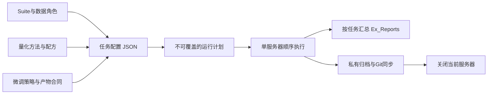

# 训练与测试框架：从一个研究任务到多轮结果

更新：2026-10-20。本次搭建与仓库整理不启动服务器、GPU或旧计划。

## 1. 三个模块与一个统一入口



入口：`python -m qvla.infra`。配置、计划与统计使用Python标准库；不会因为查看配置而加载CUDA。模型后端继续使用现有OFT环境与冻结版本。

| 模块 | 已提供 | 实际边界 |
|---|---|---|
| Suite | `libero_spatial/object/goal/10`，每个suite独立初态范围、种子和数据清单 | 内置评测执行所选suite的全部任务；多suite模型身份要重新核验，不能借历史Spatial模型SHA |
| 量化 | AWQ、SmoothQuant、BF16参考；W/A位宽、profile SHA、配方参数 | 复用现有数值实现；当前属于fake quant研究路径，不称真实低比特内核加速；不是任意组合都已实测 |
| 微调 | none、LoRA、Response-SVD LoRA、Routing注册项及版本化命令绑定 | 历史训练器有A4/Spatial/数据/步数限制；新的量化×微调×suite组合必须提供自己的绑定和必要门禁，不静默套用旧模型 |
| 结果 | suite/cohort/model分组JSON与CSV、完整配对比较、失败与中断、成本 | 重复回合拒绝，跨协议不配对，缺失/异常不伪装为模型失败；探索p值不是无偏最终显著性证明 |

OFT官方支持四个suite及四suite联合训练检查点，见[官方LIBERO说明](https://github.com/moojink/openvla-oft/blob/main/LIBERO.md)。量化原始实现来源：[AWQ](https://github.com/mit-han-lab/llm-awq)、[SmoothQuant](https://github.com/mit-han-lab/smoothquant)。本框架复用的是仓库已有适配，接入不等于论文复现通过。

## 2. 下次用户开机后的最短流程

用户先提供：任务内容、已开启的服务器ID/地址、需改变的变量与预算。Agent完成配置和检查，然后执行；不自动开机或开卡。

```bash
git clone https://github.com/zsure27/VLA-Quant.git
cd VLA-Quant
# 已有checkout则先保存自己的修改，再git pull --ff-only。
python -m qvla.infra list
python -m unittest discover -s tests -p 'test_infra_*.py'
```

模型、数据、官方量化源码和OFT环境不随普通Git下载。复用已有服务器环境，按[原环境入口](../scripts/activate_oft.sh)激活，确认OFT overlay已安装；只在需要时按[恢复索引](../backups/github/README_CN.md)下载私有原始材料，不恢复全部历史包。

1. 复制`configs/infra/awq_multisuite.example.json`到本次配置；可换用SQ/BF16模板。填入实际任务开始时间、中文名、检查点和profile完整SHA、数据manifest与实际服务器。模板的全零SHA和过期授权有意不能执行。
2. 建立研究任务ID。同一任务以后补跑使用同一个任务卡；更换`round_id`和全新的`run_dir`。多个量化/微调候选使用不同配置和模型ID；共享配对条件才共享`cohort_id`。
3. 新组合只验证实际变化的输入、梯度、finite、冻结和保存重载；复用正确缓存。先小片筛查，多类单变量探索，不默认450或全组合网格。
4. 编译独立计划：

```bash
python -m qvla.infra plan .local/current-task.json \
  --run-dir /root/autodl-tmp/qvla-repro/infra-runs/TASK/round-01 \
  --output .local/round-01.plan.json
```

5. 用户本轮开机授权写成`authorization.example.json`所示收据，绑定实际hostname、server_id、config SHA、round_id及到期时间，同时授权本轮关服务器。此收据保存在运行服务器/控制端的私有工作目录。
6. 控制端以当前任务`get_usage_limits` API采集五小时primary，原子写入服务器私有`quota.json`：`source=codex_api`、`window_minutes=300`、`observed_at`、`remaining_percent`、`resets_at`。不能从时钟推测刷新、使用历史值或读取登录令牌冒充额度API。服务器本身没有Codex账号额度API，必须由控制端送入。
7. 启动本轮：

```bash
python -m qvla.infra run .local/round-01.plan.json \
  --authorization .local/round-01.authorization.json \
  --round-id round-01 --quota .local/quota.json --execute
```

用终端管理器或受控后台进程保持入口运行。仅对这一个当前授权实例执行。入口锁拒绝重复启动；中断后保留锁和原始状态，新轮不覆盖旧轮。

## 3. 心跳与额度

默认每900秒读取一份`status.json`、实际进程/GPU/盘；未变静默，不读逐回合日志。阶段变化、完成、失败、阈值或需用户处理时才通知。服务器内部每秒仅检查子进程存活，每60秒只读本地额度文件，不发网络轮询；GPU/盘状态每15分钟采样。

控制端为当前任务创建15分钟thread heartbeat，保持原有“未变静默”偏好；任务结束暂停该心跳。**现在不创建活跃实验心跳**。控制端每次刷新额度文件；默认超过1020秒没有新鲜值时保守收尾，不能无限等待付费空转。API时间/窗口有误则先输出问题并收尾。

- 剩15%：停止启动后续阶段/新GPU扩展，保存已有证据，当前正常阶段可继续至10%或自然结束。
- 剩10%：默认进入收尾，保存中断事实，停止本轮子进程组，确认GPU闲，关当前服务器；预留3%。门限可在本轮配置调整，必须在起跑前确定。
- 任务完成、无法解决的实验问题或授权问题：先说明问题，保存已有数据/结果，进行Git与备份同步，再请求关闭当前服务器。上传失败时在服务器持久盘保留完整材料和失败清单，仍尝试原生停机，不删除未核验数据。
- 关机授权被拒、hostname不符、GPU仍活动或原生机制改变：记录`SHUTDOWN_BLOCKED`并明确告知“服务器未确认关闭”，不得绕过审批或假报成功；由控制端尽快处理。

此规则覆盖旧的“关键上传失败一直保持实例”约定。`execute=true`仅表示已发出原生请求，平台OFF/计费仍需独立确认。Windows关机不属于本框架默认动作。

## 4. 数据与训练绑定

`data.training`和`data.calibration`可以各选多个suite，必须固定每份manifest SHA。每条样本提供`file`、`sha256`、role，以及suite和轨迹或初态身份；可复用历史的`sample_sha256/trajectory_role`等明确字段。执行前验证内容、角色及train/calibration/eval分离。offline轨迹ID与simulator reset不能混用，`offline_final_holdout`不进入本探索框架。

当前内置量化评测使用**已校准profile**。生成新profile可复用`qvla/calibrate_official_quant.py`；其`--samples-dir`必须是经过角色审计、配额明确的多suite校准集合，不能把Spatial profile改名为multisuite。校准也是有成本的任务项，按同样规范记录。

LoRA/Routing等使用`binding`：

- `id`固定版本；`verified_suites/quantizers/strategies`明确适用范围。
- `gate_files`固定门禁文件SHA及预期gate；运行前实读检查。
- `training_argv → post_training_audit_argv → evaluation_argv → evaluation_audit_argv`按顺序执行，任一失败进入收尾。
- 变量仅以argv占位符传递：`{repo}/{python}/{run_dir}/{checkpoint}/{suite}/{offset}/{count}/{output}`，不使用shell拼接或把密钥写入配置。
- 模板中的`/ABSOLUTE/PATH/`需替换为真实独立版本入口。历史`train_extended_peft.py`、`train_b3_initialization_v1.py`、`train_b5_router.py`可供复用，不能解除它们既有身份/数据限制来凑兼容。

增加方法：在可信插件模块调用`register_quantizer`、`register_strategy`或`register_suite`，再用`python -m qvla.infra --plugin my_package.plugin plan ...`。新增组件默认走显式命令绑定；数值合同由该组件实现，注册成功不是实验门禁通过。

## 5. 按任务记录与统计

一个任务只有一个主文件：`Ex_Reports/YYYYMMDD_HHMM_中文任务名.md`。**先写整合结果和分析，再追加多轮运行日志**。细项在`Ex_Reports/_tasks/TASK/`；`SUMMARY.md`是人工审阅的综合结论，`runs/ROUND.json`保存各轮真实执行状态。框架不从退出码自动编造模型结论。

```bash
python -m qvla.infra aggregate episodes.json --output Ex_Reports/_tasks/TASK/scores.json
python -m qvla.infra compare episodes.json --baseline reference --candidate candidate \
  --output Ex_Reports/_tasks/TASK/paired.json
python -m qvla.infra report TASK
```

episode规范见`configs/infra/episodes.example.json`。各后端的原始日志须由对应审计器转为该格式；没有通过实际argv、seed、finite、异常和视频/输入覆盖审计，不填`status=completed`。额外训练、校准、教师和加载成本在任务总结单列；闭环query成本不能冒充推理内核速度。

历史整理：21个任务类，将原reports/results字节归入`Ex_Reports/_legacy`；`migration-manifest.json`记录每项来源、归属、大小与SHA。工作区换行SHA与Git标准化blob SHA分别记录，跨系统校验使用对应字段。旧脚本需要原路径时，可在**服务器**运行`python -m qvla.infra legacy-links --apply`创建目录链接；不复制归档。迁移不改冻结源码/参数/锁，不据历史RUNNING重开实验。

## 6. 备份与关机

详见[运行与备份规范](EXPERIMENT_OPERATIONS_CN.md)。默认闭环为：停止本轮进程 → 持久盘保存原始材料及成员SHA → 私有Release上传并下载验SHA → 更新任务文件/恢复索引 → 推送普通Git并核验远端SHA → 原生关服务器 → 控制端收集关机收据、补齐任务结论、暂停心跳。

`infra_archive_run.py`只打包本轮目录，复用已审计的256MiB分块/流式下载核验传输；默认最多上传2GiB、2路并行，不重复搬运历史大包。`infra_git_sync.py`只提交当前任务的小文本，不用`git add -A`，原始文件不删除。代码更改应在起跑前推送；运行中的必要修复也须按明确文件清单提交同步，不能仅提交结果忽略代码。

当前框架已做7项CPU控制与故障路径验证；本轮没有用户开启的新服务器，因此没有开展真实GPU训练、跨suite数值验证或真实关机测试。下一轮只需对实际新组合补必要门禁。

仅准备备份并检查流量预算：`python scripts/infra_archive_run.py --run-dir RUN --prepare-only`。已准备/中断快照保留后，用原`RUN/.closure/upload-plan.json`和独立回执调用`github_archive_store_v3.py --workers 2`续传，避免重压缩。同步新增代码时，在本轮`git_sync_argv`中以重复`--include 相对文件`列明已审阅路径；未列入的工作文件不被批量提交。
